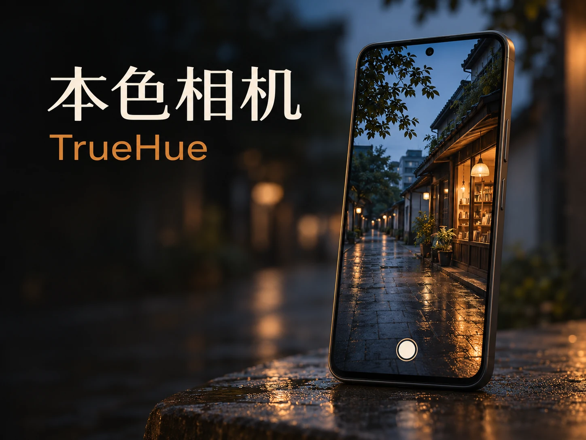

# 本色相机 · TrueHue

TrueHue 是一款开源 Android 相机，适合拍夜街、室内暖灯和远处的细节。它在手机上处理照片，尽量保留现场光的冷暖和暗部层次。按下快门，就能得到可直接分享的照片。

**Android 12 及以上 · 小米 17 三枚后置镜头实测**

[获取与安装](#获取与安装) · [设备支持](#设备支持) · [v0.8.1 更新说明](CHANGELOG.md)



## 用它拍什么

- **夜街、逆光与室内美食。** 「原彩直出」在自动白平衡时保留现场灯光的冷暖氛围，通过主体加权测光、高饱和亮部高光保护与无光晕局部影调恢复保留暗部层次和真实色彩，成片使用 Display P3 广色域。也可在右下角选择「光影」等风格。
- **高速抓拍与可选暗光多帧。** 默认单帧高速原彩直出，拍完即解锁快门并后台冲洗，结合边缘保持单帧降噪兼顾速度与纯净度；在「拍摄设置」开启「暗光多帧降噪」后，极暗环境下自动切入多帧选优合成。
- **应用内相册与即时回看。** 点击左下角缩略图即可在应用内左右滑动对比多张照片、通过底部胶片条或三列「本色相册」浏览 `DCIM/TrueHue/` 成片、双指缩放至 5× 检查细节，并可直接删除或分享；Android 14 及以上在应用内即可直接观看「亮彩」高光，后台显影中提前点开也能自动滑入成片。
- **给后期留一份底片。** 在「原彩」模式开启顶部「存底片」，拍照时会在 JPEG 旁额外保存一份 DNG，方便以后调整曝光和色彩。

## 设备支持

- **小米 17** 已实测 17 mm 超广角、23 mm 主摄和 60 mm 长焦，原彩竖拍 JPEG 为 3072 × 4096。
- **其他 Android 12 及以上设备**能使用哪些镜头和「原彩」，取决于厂商开放的 Camera2 能力。镜头无法提供 RAW 时，会尝试使用系统 JPEG「高清直出」或取景帧「极速快拍」。实际模式会显示在取景页。
- **Android 14 及以上**可在「原彩」模式开启「亮彩」，让支持 Ultra HDR 的相册和屏幕呈现更亮的高光。普通相册也能打开同一张 JPEG。

## 获取与安装

**v0.8.1 开发版可从当前源码构建安装。** 已发布版本的源码可从 GitHub 发布页下载。[查看已发布版本](https://github.com/AyingAI/truehue/releases)

1. 安装 JDK 17，并通过 Android Studio 的 SDK Manager 安装 Android Platform 35、Build Tools 35.0.0 和 Platform Tools。将 `ANDROID_HOME` 指向 Android SDK 目录。
2. 在手机上打开 USB 调试，用数据线连接电脑，并在手机上确认授权。
3. 在解压后的项目目录运行以下命令。首次构建会下载依赖。

```sh
./gradlew :app:installDebug
```

Windows 使用 `gradlew.bat :app:installDebug`。覆盖安装时，应用需要使用与手机上已有版本相同的签名。

## 拍第一张照片

1. 打开本色相机并授予相机权限。首次进入取景时会弹出使用指南，也可从顶部重新打开。
2. 在取景框下方切换镜头。轻点画面对焦、长按锁定，上下滑动调整亮度。想调整冷暖可用「色调」，想换风格可点右下角。
3. 按下快门，点左下角缩略图即可在应用内左右滑动对比、通过底部胶片条或右上角网格总览 `DCIM/TrueHue/` 照片、双指放大看细节、分享或删除，无需跳出到系统相册。

在「拍摄设置」中可切换「极速快拍」，直接保存取景画面。想提前看原彩显影的效果，可开启「原彩预览」，取景刷新会慢一些。直方图和专业拍摄参数也在这里，应用版本显示在设置底部。

## 隐私

拍照无需账号和网络连接。应用只申请相机权限（不申请读写手机全部相册权限），通过 Android 分区存储在本地浏览和管理本应用拍摄的 `DCIM/TrueHue/` 照片，取景、显影和保存都在手机上完成。仅在主动点击系统相册打开或分享时，Android 才会把所选照片的读取权限交给处理该操作的应用。

JPEG 和 DNG 可能包含拍摄时间、设备型号和曝光参数。系统生成的 JPEG 和 DNG 也可能带有其他相机元数据。TrueHue 不请求定位权限，也不写入 GPS 坐标。

## 开发与测试

<details>
<summary>展开本地构建和测试命令</summary>

项目包含 Gradle 8.9 Wrapper。以下命令构建调试 APK、运行 Lint，并生成未签名的 Release APK。

```sh
./gradlew :app:assembleDebug :app:lintDebug :app:assembleRelease
```

调试 APK 位于 `app/build/outputs/apk/debug/app-debug.apk`。Release APK 可用自己的 Android 签名密钥签名。

纯 Java 检查使用合成像素和镜头标定参数，覆盖 Bayer 插值、白平衡、色彩矩阵、多帧融合、降噪、滤镜、影调及 HDR 增益图。以下命令另在 256 MiB Java 堆下验证 4096 × 3072 显影。快速检查可以省略 `--full`。

```sh
classes=$(mktemp -d)
javac -d "$classes" \
  app/src/main/java/com/truehue/camera/{BayerPipeline,BurstRawMerger,PhotoFilter,SensorColorMatrix,HighlightMeter,UltraHdrPatcher}.java \
  tests/RawDevelopmentCheck.java
java -Xmx256m -cp "$classes" com.truehue.camera.RawDevelopmentCheck --full
```

在已授予相机权限的小米 17 上运行真机检查。测试会拍照并写入系统相册。

```sh
./gradlew :app:installDebug :app:installDebugAndroidTest
adb shell am instrument -w com.truehue.camera.test/com.truehue.camera.LensSmoke
```

- 默认检查三枚镜头的 RAW 预览、JPEG 尺寸、EXIF、Display P3 ICC 配置和 Android 14 及以上的 Ultra HDR 增益图，并验证主摄可保存 DNG。
- 在测试类名前加 `-e exposureOnly true` 可检查高光测光、单帧曝光锁和重建相机会话后的曝光补偿。加 `-e settingsOnly true` 可检查设置、回看和滤镜保存。加 `-e panelsOnly true` 可检查首次启动指南、窄屏顶部按钮和快捷开关。
- 加 `-e regressionsOnly true` 可检查后台取消拍摄、连续拍摄的回调顺序、相册分页和删除范围，以及显影失败时的 DNG 恢复。测试会创建并清理自己的临时样本。
- 请保持手机解锁。如果系统拦截后台启动，在测试输出「正在打开本色相机」时从手机上打开应用。

</details>

## 许可证

TrueHue 使用 [Apache License 2.0](LICENSE)。Gradle Wrapper 保留了上游的许可证和版权声明。
